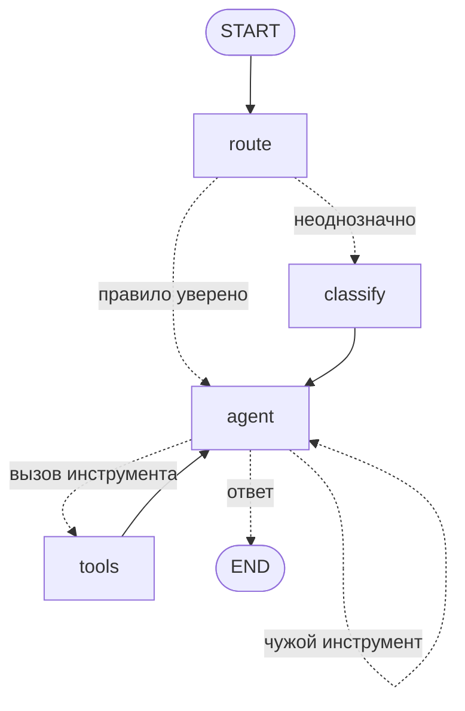

# seller — ИИ-продавец на LangGraph

Тот же продавец автомагнитол, что работает на сайте (`lib/ai/agents`, TypeScript, прямой SDK),
собранный графом состояний на LangGraph. Данные — каталог проекта (`seed/demo-data.json`:
40 автомобилей, 246 позиций, 286 комплектов).



- **route** — правила без модели (`seller/router.py`): заказ, возражение, допродажа, авто, товар, приветствие.
  Покрывают большинство сообщений за ~0 мс и бесплатно. Каждое решение несёт причину — для аналитики маршрутов.
- **classify** — модель отвечает одним словом, только когда правила не уверены. Непонятный ответ → greeter.
- **agent** — модель с инструментами своей роли (`seller/prompts.py`). Попросила инструмент чужой роли —
  граф не исполняет ни один вызов из этого ответа и возвращает отказ текстом, модель отвечает заново.
- **tools** — шесть инструментов поверх каталога. `place_order` считает состав по ценам и остаткам каталога
  (не по тому, что модель запомнила в диалоге) и **останавливает граф** (`interrupt`) до решения человека.
  Решение передаётся `Command(resume={"approved": True})`.
- **Чекпоинты.** Диалог хранится по `thread_id`. С `SqliteSaver`/`PostgresSaver` остановленный заказ
  переживает перезапуск: клиент нажал «беру» вечером, менеджер подтвердил утром из другого процесса.

## Запуск

```bash
uv sync
uv run pytest        # 36 тестов
```

Модель подключается любая с `bind_tools` (`BaseChatModel`): GigaChat через `langchain-gigachat`,
Claude через `langchain-anthropic`, локальная через `langchain-ollama` — граф от этого не меняется.
В тестах модель-сценарий (`tests/conftest.py`): отдаёт заготовленные ответы и запоминает, что ей прислали.
Так проверяется сам граф — сколько раз зовут модель, куда уходят вызовы инструментов, где граф встаёт.

## Шлюз моделей на LiteLLM

Роли графа обращаются к псевдонимам, а не к провайдерам (`seller/gateway.py`):

| Псевдоним | Роли | Если упал |
|---|---|---|
| `seller-fast` | классификатор, приветствие, возражения, допродажа | — |
| `seller-smart` | подбор комплекта, оформление заказа | запрос уходит на `seller-fast` |

```python
ledger = CostLedger()
router = make_router(ledger=ledger)        # модели из SELLER_FAST_MODEL / SELLER_SMART_MODEL
graph = build_graph(model, catalog, saver, role_models=role_models(router))
ledger.by_alias   # {"seller-fast": {"calls": 2, "tokens": 60, "cost": 0.00022}, ...}
```

- Смена провайдера — переменная окружения в формате LiteLLM (`anthropic/…`, `openai/…`, `ollama/…`),
  граф и промпты не меняются.
- Дешёвые роли не платят за сильную модель; подбор и заказ не остаются без ответа, если сильная легла.
- `CostLedger` пишет вызовы, токены и деньги по псевдониму и считает сбои — видно, как часто
  срабатывает запасная модель. Цены берутся из таблицы LiteLLM.
- Тесты без ключей: вместо провайдера `mock_response`, «упавшая» модель — закрытый порт.

## Трейсы OpenTelemetry

Один ход диалога — один трейс (`seller/telemetry.py`). Подключается колбэком, граф о трейсинге не знает:

```python
provider = setup_tracing("seller")            # OTLP, если задан OTEL_EXPORTER_OTLP_ENDPOINT
graph.invoke(state, {"configurable": {"thread_id": tid},
                     "callbacks": [TracingCallback(provider.get_tracer("seller"), prices)]})
```

Так выглядит ход «kia rio» в Jaeger (живой прогон, цены условные — 1 и 5 за миллион токенов):

```
seller.turn            agent=product_finder routing=rule  in=3700 out=130 cost=0.00435
├── node route
├── node agent
│   └── chat <модель>  in=1200 out=40  cost=0.0014  tool_calls=[find_kit_for_car]
├── node tools
│   └── tool find_kit_for_car
└── node agent
    └── chat <модель>  in=2500 out=90  cost=0.00295
```

- Атрибуты по семантике OpenTelemetry для GenAI: `gen_ai.request.model`, `gen_ai.usage.input_tokens`,
  `gen_ai.usage.output_tokens`, `gen_ai.tool.name`; свои — `seller.agent`, `seller.routing`, `seller.cost`.
- Цены передаются снаружи: у провайдеров они свои и меняются. Нет цены — токены пишутся, стоимость нет.
- Остановка перед заказом (`interrupt`) помечается `seller.interrupted`, а не ошибкой: иначе каждая
  заявка, ждущая менеджера, выглядела бы в дашборде как сбой.
- Внутренние runnable LangGraph (запись каналов, функции переходов) спанов не получают, их потомки
  вешаются на ближайший узел — трейс читается по узлам графа.

Посмотреть локально: `docker run --rm -p 16686:16686 -p 4318:4318 jaegertracing/jaeger`,
`OTEL_EXPORTER_OTLP_ENDPOINT=http://127.0.0.1:4318`, интерфейс на http://localhost:16686.

## Что проверяют тесты

| Тест | Что гарантирует |
|---|---|
| `test_router.py` | 13 живых фраз и их маршрут, «как заказать?» не уводит к оформлению, кириллица на границе слова |
| `test_rule_routing_skips_classifier` | уверенное правило → один вызов модели, классификатор не платится |
| `test_ambiguous_message_goes_through_classifier` | неоднозначное → два вызова: классификатор и агент |
| `test_agent_uses_catalog_tool` | цикл agent ⇄ tools, ответ инструмента доходит до модели |
| `test_foreign_tool_is_not_executed` | приветствие не может оформить заказ, даже если модель попросит |
| `test_order_waits_for_human…` / `test_rejected_order…` | до подтверждения заказ не записан; отказ не записывает |
| `test_order_resumes_in_new_process` | остановленный заказ подтверждается новым экземпляром графа из SQLite |
| `test_checkpoint_keeps_dialog_per_thread` | история копится по диалогу, чужие диалоги не смешиваются |
| `test_telemetry.py` | трейс хода: узлы, вызовы модели и инструмента в одном трейсе, токены и стоимость, остановка не ошибка |
| `test_gateway.py` | роли идут на свой уровень, сильная модель легла — ответ с запасной, журнал считает вызовы, сбои и деньги |
| `test_catalog.py` | цены из каталога, больше остатка не продаём, нет в наличии — пропуск с предупреждением |

## LangGraph или прямой SDK — вывод на одной задаче

Логика маршрутизации у обеих версий одна, поэтому число вызовов модели одинаковое:
уверенное правило — один вызов, неоднозначное — два, плюс по вызову на каждый круг инструментов.
Разница в том, что вокруг.

**Что дал LangGraph**
- Остановка перед действием и продолжение позже — встроенные (`interrupt` + чекпоинт). В TS-версии
  `place_order` пишет заказ сразу: подтверждение человеком там пришлось бы строить самому —
  хранить незавершённый вызов, восстанавливать историю, следить за повторным нажатием.
- Состояние диалога и место остановки сохраняются без своего кода; `get_state` показывает, где граф стоит.
- Схема графа строится из кода (`get_graph().draw_mermaid()`), её видно на ревью и в документации.
- Тестировать удобно: модель подменяется целиком, проверяются переходы, а не тексты ответов.

**Где мешает**
- Код узла до `interrupt` при возобновлении выполняется **заново** — весь узел, включая соседние вызовы
  инструментов. Поэтому до `interrupt` в `place_order` только расчёт по каталогу, запись после.
  Неочевидно и легко получить двойную запись.
- `ToolNode` прячет исполнение: таймауты, повторы и учёт стоимости по инструменту приходится навешивать
  отдельно. В TS-версии это обычный цикл, который видно целиком.
- Плюс зависимость и её версии (`langgraph` 1.2, `langchain-core` 1.6) — API в этой экосистеме меняется быстро.

**Как выбираю:** LangGraph — где есть остановки на человека, долгие диалоги и ветвления, которые важно
видеть схемой. Прямой SDK — где важен контроль каждого вызова и его стоимости и сценарий линейный.
